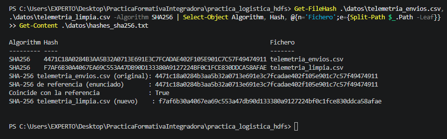
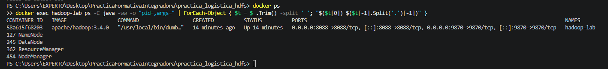
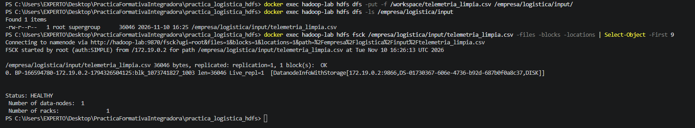
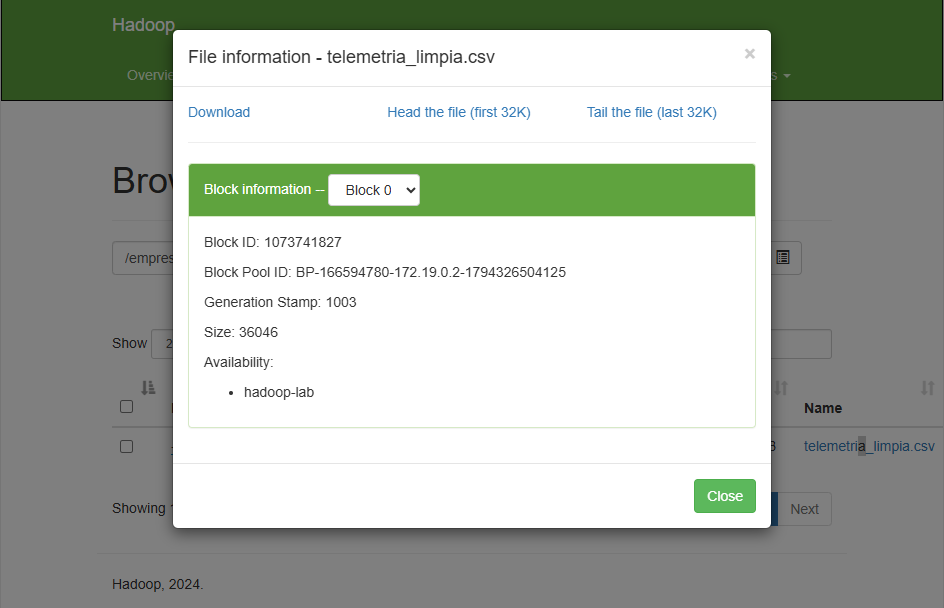

# Práctica Sesión 11: integridad del dato e ingesta en HDFS

Módulos 5075 y 5074. Telemetría logística: verificación con SHA-256, saneado del dataset e ingesta en HDFS (Hadoop 3.4.0 en Docker).

## Estructura del repositorio

```
README.md
practica_logistica_hdfs/
    datos/        dataset original, limpio, rechazados y hashes
    scripts/      calidad_dataset.py (hashes + saneado, reproducible)
    evidencias/   capturas de pantalla
    docker-compose.yml
```

## 1. Hashes SHA-256 antes y después del saneado

| Fichero | SHA-256 |
|---|---|
| `telemetria_envios.csv` (original) | `4471c18a0284b3aa5b32a0713e691e3c7fcadae402f105e901c7c57f49474911` |
| Hash de referencia del enunciado | `4471c18a0284b3aa5b32a0713e691e3c7fcadae402f105e901c7c57f49474911` |
| `telemetria_limpia.csv` (tras el saneado) | `f7af6b30a4067ea69c553a47db90d133380a9127224bf0c1fce830ddca58afae` |

El hash del original **coincide** con el de referencia, lo que confirma que el fichero de partida no ha sido alterado. El hash del limpio es distinto, como debe ser: al eliminar filas cambia el contenido.

### Saneado aplicado

El script lee todo como texto (sin pandas, para no alterar ningún valor) y escribe UTF-8 sin BOM con saltos LF. De 300 filas quedan **292 limpias** y **8 rechazadas**:

| Regla | Filas rechazadas |
|---|---|
| Duplicado exacto (se conserva la primera aparición) | ENV-2026-1012, ENV-2026-1078 |
| Nulo en `temp_celsius` | ENV-2026-1015 |
| Nulo en `peso_kg` | ENV-2026-1067 |
| Nulo en `destino` | ENV-2026-1189 |
| Peso <= 0 (-45.50) | ENV-2026-1088 |
| Temperatura fuera de [-30, 40] (98.4) | ENV-2026-1142 |
| Estado fuera de {ENTREGADO, EN_TRANSITO, EN_REPARTO, INCIDENCIA_REPARTO} | ENV-2026-1210 |

Las filas rechazadas, con su motivo, quedan en `datos/telemetria_rechazados.csv`.

### Nota sobre la integridad del dato

Al empezar solo se disponía de `telemetria_envios.xlsx` (SHA-256 `9ae5d0a2ccad70cb5466bb4717563d7c71a42be13a5cde7b431ddffbe964e655`) y de un CSV exportado desde Excel (SHA-256 `317f5047ddc0407b36fe4b8af54b919e5a2f815555c5c1b0c176cff4e0df0181`). Ninguno coincidía con la referencia: Excel había convertido temperaturas en fechas, había perdido el punto decimal de las coordenadas (`36.64536` pasaba a `3.664.536`) y había cambiado los saltos de línea y la codificación. Ese es un ejemplo práctico de por qué se compara el hash antes de trabajar con un fichero. El CSV original se obtuvo después y su hash sí coincide.

### Reproducir

```
python practica_logistica_hdfs/scripts/calidad_dataset.py
```

Genera `telemetria_limpia.csv`, `telemetria_rechazados.csv` y `hashes_sha256.txt` en `datos/`, y avisa si el hash del original no coincide con el de referencia.

## 2. Despliegue, puertos y comandos HDFS

### Despliegue

Entorno: Windows, PowerShell y Docker Desktop. Un único contenedor, `hadoop-lab`, con la imagen `apache/hadoop:3.4.0` y usuario `root`. El fichero `docker-compose.yml` define:

- Volumen `./datos` montado en `/workspace` dentro del contenedor, para que HDFS vea los ficheros locales.
- `dfs.replication=1`, porque solo hay un DataNode.
- Arranque manual de los cuatro demonios: NameNode, DataNode, ResourceManager y NodeManager. Se usa este modo en vez del "standalone" del enunciado porque esa opción no existe en esta imagen.

```
cd practica_logistica_hdfs
docker compose up -d
```

### Puertos

| Puerto | Servicio | Publicado en el host |
|---|---|---|
| 9870 | Web UI del NameNode (http://localhost:9870) | Sí |
| 8088 | Web UI del ResourceManager (http://localhost:8088) | Sí |
| 9866 | Transferencia de datos del DataNode (aparece en `fsck`) | No, solo interno |

### Comprobación de los demonios (jps)

La imagen `apache/hadoop:3.4.0` **no incluye `jps`**. Como equivalente se listan los procesos Java del contenedor y se muestra el nombre de la clase principal de cada uno:

```
docker exec hadoop-lab ps -C java -ww -o "pid=,args=" | ForEach-Object { $t = $_.Trim() -split ' '; "$($t[0]) $($t[-1].Split('.')[-1])" }
```

La salida muestra `NameNode`, `DataNode`, `ResourceManager` y `NodeManager`.

### Comandos HDFS

Todos se ejecutan con `docker exec hadoop-lab ...` desde PowerShell.

```
# Crear la ruta e ingerir el fichero limpio
hdfs dfs -mkdir -p /empresa/logistica/input
hdfs dfs -put /workspace/telemetria_limpia.csv /empresa/logistica/input/

# Listar y leer
hdfs dfs -ls /empresa/logistica/input
hdfs dfs -cat /empresa/logistica/input/telemetria_limpia.csv
hdfs dfs -head /empresa/logistica/input/telemetria_limpia.csv
hdfs dfs -tail /empresa/logistica/input/telemetria_limpia.csv

# Bloques y ubicación
hdfs fsck /empresa/logistica/input/telemetria_limpia.csv -files -blocks -locations
```

Observaciones:

- `-head` y `-tail` trabajan en bytes, no en líneas: muestran el primer y el último kilobyte, y pueden cortar una fila a medias. Para ver las 10 primeras líneas se usa `hdfs dfs -cat ... | head -n 10`.
- Al truncar `-cat` con `head`, HDFS imprime `cat: Unable to write to output stream.` No es un error del fichero: `head` cierra la tubería tras leer sus 10 líneas.

### Resultado de `fsck`

| Dato | Valor |
|---|---|
| Fichero | `/empresa/logistica/input/telemetria_limpia.csv` |
| Tamaño | 36046 bytes |
| Bloques | 1 (`blk_1073741825_1001`, `len=36046`) |
| Replicación | 1 |
| DataNode que lo guarda | `172.19.0.2:9866` |
| Estado | HEALTHY (0 bloques corruptos, 0 perdidos) |

El fichero cabe en un solo bloque, que ocupa en disco solo lo que pesa el fichero y no los 128 MB del tamaño de bloque.

## 3. Análisis crítico: ¿por qué un fichero en HDFS no se corrompe ni se pierde aunque falle un DataNode?

HDFS no guarda un fichero como una pieza única en un disco, sino que lo divide en bloques (128 MB por defecto) y guarda cada bloque en varios DataNodes. En un clúster de producción el factor de replicación es 3, y la colocación de las réplicas tiene en cuenta los racks: la primera copia va al nodo que escribe, la segunda a un nodo de otro rack y la tercera a otro nodo del mismo rack que la segunda. Así, el fallo de un disco, de un nodo o incluso de un rack completo deja siempre alguna copia accesible. El NameNode no almacena los datos, solo los metadatos: qué bloques forman cada fichero y en qué DataNodes está cada réplica.

La pérdida se evita porque el NameNode vigila continuamente ese estado. Cada DataNode envía latidos (cada 3 segundos por defecto) e informes periódicos de los bloques que guarda. Si un DataNode deja de dar señales durante unos 10 minutos, el NameNode lo da por muerto, detecta que los bloques que alojaba tienen menos réplicas de las debidas y ordena copiarlos desde una réplica sana a otros nodos hasta recuperar el factor de replicación. La corrupción se evita con sumas de verificación: HDFS calcula un CRC por cada fragmento de datos (512 bytes por defecto) y lo guarda junto al bloque. Al leer, el cliente y el DataNode recalculan y comparan, y los DataNodes además revisan sus bloques en segundo plano. Si una réplica no coincide, se marca como corrupta, se lee otra réplica y el NameNode programa una copia nueva a partir de una réplica sana.

Esta protección depende de tener réplicas, y en este laboratorio no las hay: hay un único DataNode y `dfs.replication=1`, como confirma el `fsck` (1 bloque, `Live_repl=1`, `Number of data-nodes: 1`). El fichero está íntegro y el estado es HEALTHY, pero si el DataNode fallara o su disco se dañara, el bloque pasaría a estar perdido (`MISSING`) y no habría ninguna copia desde la que recuperarlo. Las sumas de verificación seguirían detectando una corrupción, pero no habría réplica sana con la que repararla. La garantía de HDFS no es mágica: viene de la replicación (3 en producción) combinada con la detección de fallos y la re-replicación automática. Esta limitación se aceptó en el laboratorio por sencillez, y no se ha probado el fallo de un DataNode.

## 4. Evidencias gráficas

Las capturas están en la carpeta `practica_logistica_hdfs/evidencias/`.

**01. Hashes SHA-256** (`01_hashes_sha256.png`): hash del original, coincidente con la referencia, y hash del fichero limpio, calculados con PowerShell y con el script.



**02. Servicios de Hadoop** (`02_jps_servicios.png`): `docker ps` con el contenedor `hadoop-lab` y los cuatro demonios activos (NameNode, DataNode, ResourceManager, NodeManager). Como la imagen no incluye `jps`, se usa el equivalente descrito en la sección 2.



**03. Comandos HDFS y fsck** (`03_hdfs_comandos_fsck.png`): `put`, `ls` y `fsck -files -blocks -locations`, con el bloque y el DataNode que lo guarda.



**04. Web UI de HDFS** (`04_webui_hdfs_browse.png`): el fichero en `/empresa/logistica/input` desde Utilities > Browse the file system, en `localhost:9870`.


